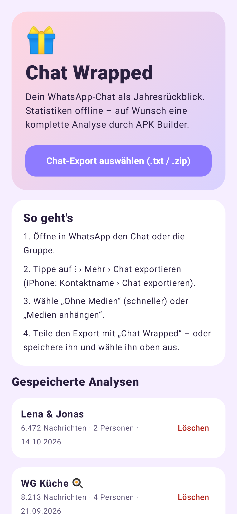
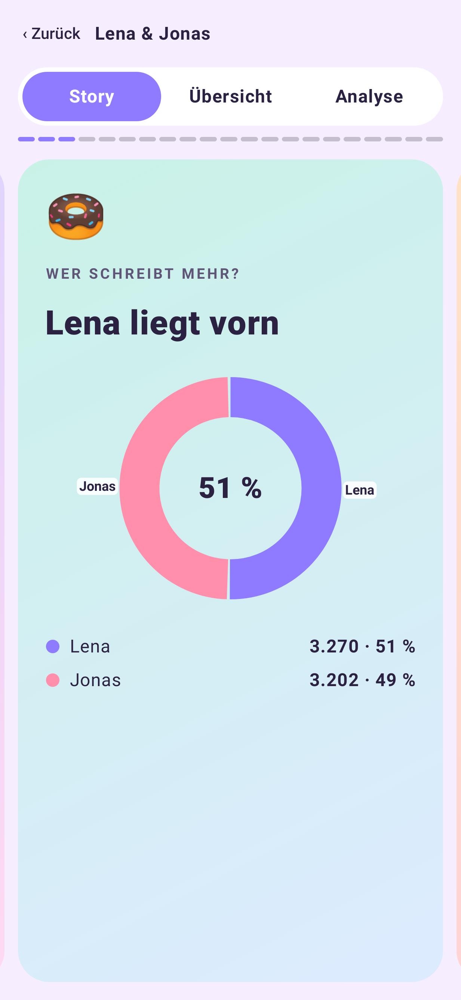
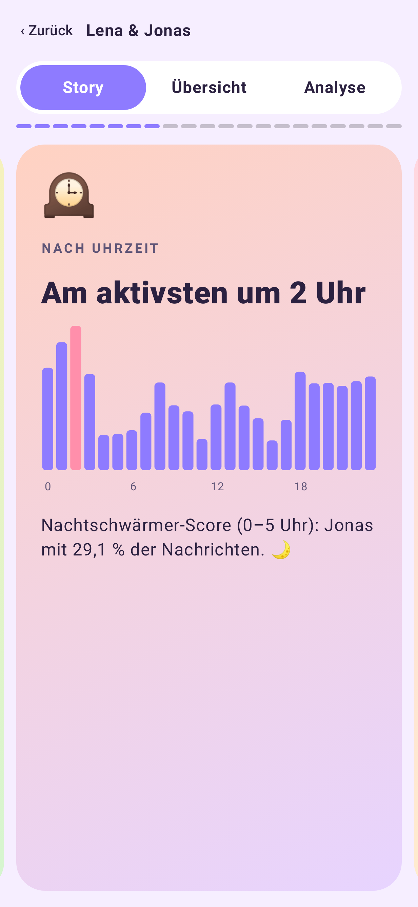
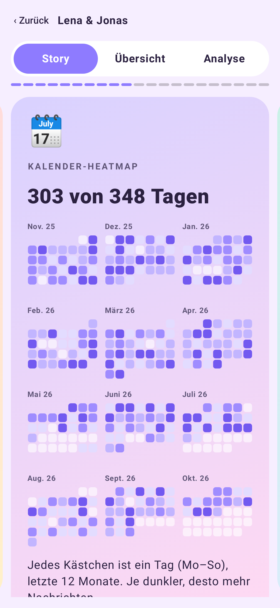
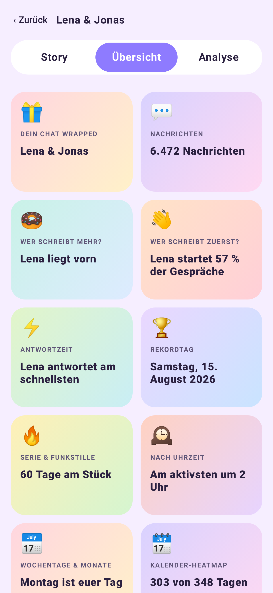
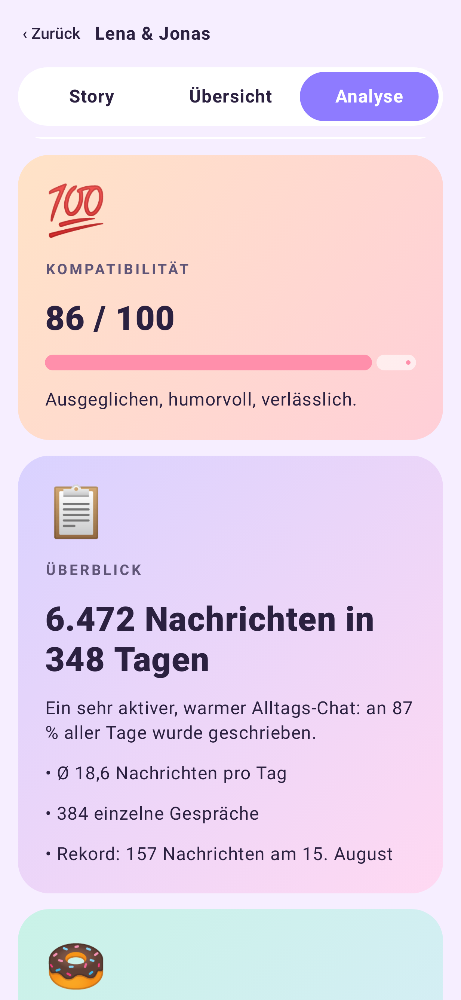
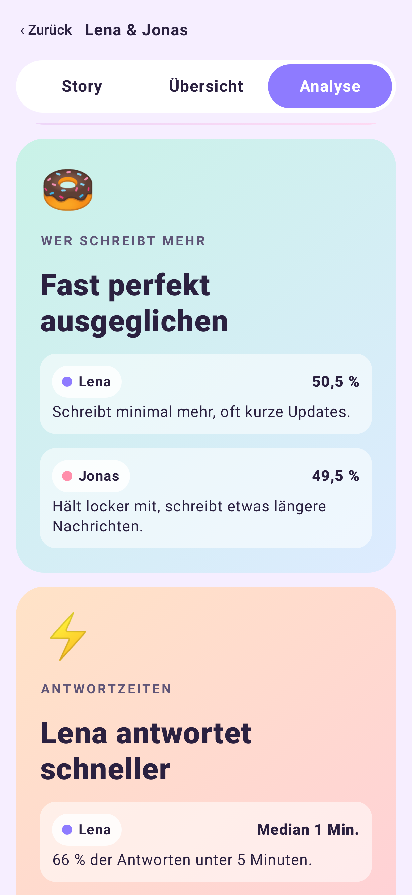
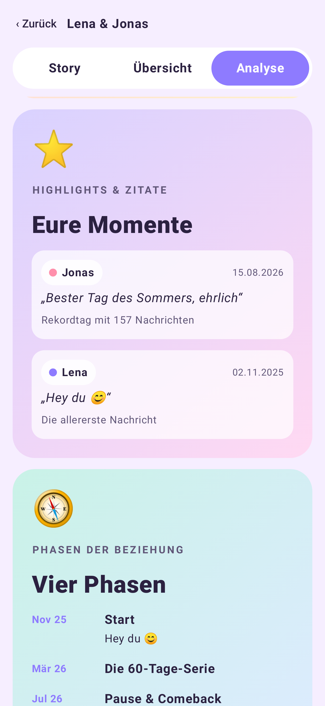
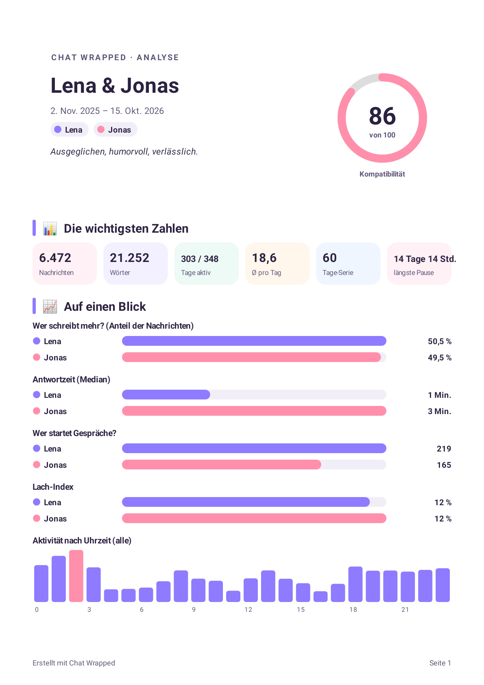

# Chat Wrapped 💬📊

**"Spotify Wrapped" for your WhatsApp chats** – an Android app that turns a WhatsApp chat export into swipeable story cards, statistics and a shareable PDF report. All statistics are computed **offline on the device**.

> 🤖 **Built with AI-assisted development (vibe coding).** I designed the features, tested them and iterated on the result; most of the code was written together with an AI coding assistant.

## Screenshots

    

   

*(All screenshots use a generated, fictional sample chat – no real messages.)*

## Features

- 📥 Import a WhatsApp export (`.txt` or `.zip`, Android & iOS formats, German/English date formats) via the share sheet
- 🃏 "Wrapped"-style story cards: who writes more, reply times, active hours, heatmap, top words & emojis, streaks, conversation starters and more
- 📈 Overview grid with charts, per-person statistics and trends
- 🧾 PDF report export
- 🔒 Offline statistics, no tracking, no account
- 🧠 Optional "analyse whole chat" mode: the chat is gzip-compressed and **end-to-end encrypted (AES-256-GCM)**, sent via an ntfy relay, and an encrypted result is fetched back (protocol in [`docs/PROTOCOL.md`](docs/PROTOCOL.md)). Disabled unless you configure your own key/topic. Explicit consent dialog before anything leaves the phone.

## Tech stack

Kotlin · Jetpack Compose (Material 3) · Android SDK 35 (minSdk 26) · Gradle Kotlin DSL · `javax.crypto` AES-GCM · JUnit + Robolectric + Roborazzi (screenshot tests)

## Build & run

Requirements: JDK 17, Android SDK 35.

```bash
./gradlew testDebugUnitTest      # unit + screenshot tests
./gradlew assembleDebug          # app/build/outputs/apk/debug/app-debug.apk
```

Release signing: create your own keystore and a `keystore.properties` (`storeFile`, `storePassword`, `keyAlias`, `keyPassword`) in the project root – both are git-ignored.

### Optional: encrypted analysis backend

Copy `analysis-config.example.json` to `analysis-config.json` (git-ignored), put in your own random ntfy topic and a random 32-byte AES key (Base64), then rebuild. Without it the feature stays hidden/disabled. Alternatively set `CW_ANALYSIS_CONFIG=/path/to/config.json`.

Test data: `tools/make_sample_chat.py` generates the fictional sample chat used by the tests.

## License

[MIT](LICENSE) © 2026 Bartuan3600
